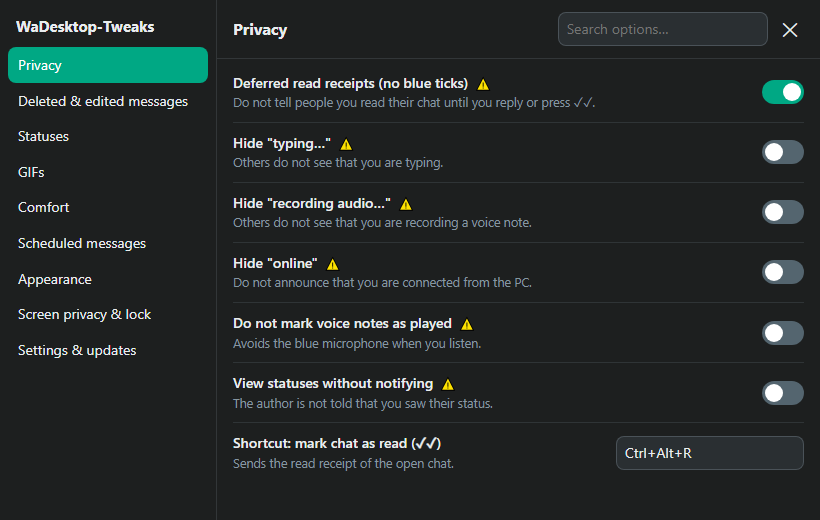
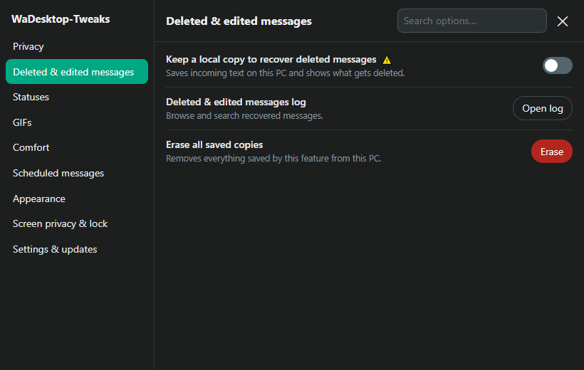
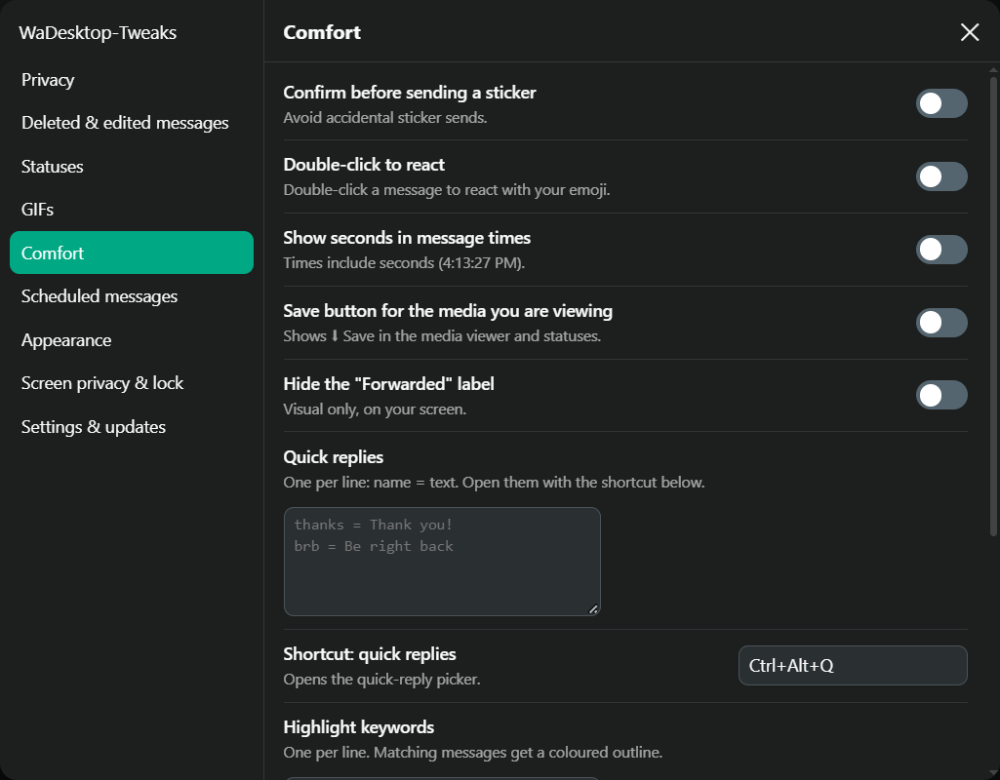
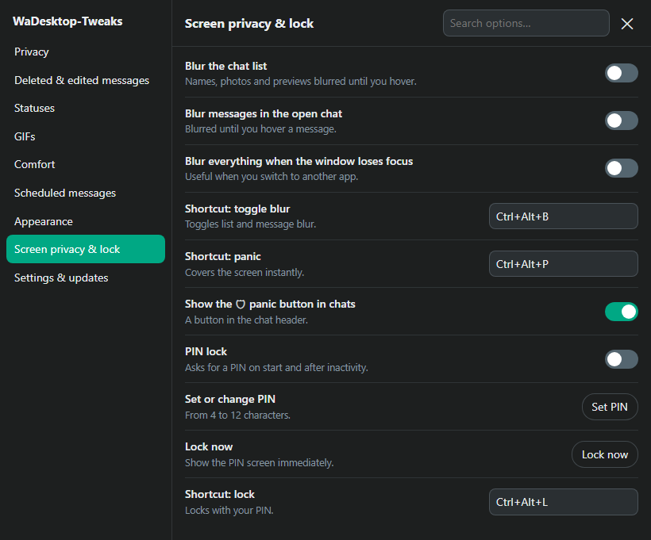

# 🧩 WaDesktop-Tweaks

**Unofficial privacy & comfort tweaks for WhatsApp Desktop on Windows.**
Deleted-message recovery · edit history · custom GIF provider · screen blur & PIN lock · profiles · 13 languages

🇬🇧 English · [🇪🇸 Español](README.es.md)

---

> [!WARNING]
> **Read this first.**
> - This is an **unofficial, community project, written with the help of an AI (Claude)**. It is **not affiliated with, endorsed by, or supported by WhatsApp or Meta**.
> - It changes how WhatsApp Desktop behaves. WhatsApp's terms do not allow modified clients, and some options here change what is sent to WhatsApp's servers or automate sending. **Your account could be restricted or banned. You use this entirely at your own risk.**
> - Options with a ⚠️ in the settings carry that risk; the ones marked ⛔ are automation and are the most likely to be flagged.
> - The code is small and readable. **Please read it before you run it** — you are giving it control over your WhatsApp window.

## ✨ What it does

| | Feature | Notes |
|---|---|---|
| 🔒 | **Deferred read receipts** | No blue ticks until you reply or press ✓✓ ⚠️ |
| 🙈 | **Hide "typing…", "recording…", "online"** | Others don't see your activity ⚠️ |
| 🎧 | **Don't mark voice notes as played** | No blue microphone ⚠️ |
| 👀 | **View statuses without notifying** | The author is not told ⚠️ |
| 🗑️ | **Recover deleted messages** | Local copy of incoming text; shown right in the chat ⚠️ |
| ✏️ | **Edit history** | See what a message said before it was edited |
| 📦 | **Statuses archive** | Optional, per-contact, with a size cap ⚠️ |
| 🎞️ | **KLIPY GIF search** | Sent as *real* GIFs through WhatsApp's own flow |
| ⏰ | **Scheduled messages** | Sent while WhatsApp is open ⛔ |
| 😀 | **Comfort** | Double-click reactions, sticker confirmation, seconds in timestamps, quick replies, keyword highlight, export chat to .txt/.json, save-media button |
| 🎨 | **Appearance** | Bubble colours, compact mode, smooth mouse-wheel scrolling, hide Channels/Communities/Meta AI/Status, custom CSS |
| 🛡️ | **Screen privacy** | Blur chat list / messages / when the window loses focus, **PIN lock**, **panic button** |
| 👤 | **Profiles & backup** | Switch option sets, export / import settings |
| 🩺 | **Self-diagnosis** | Tells you which feature broke after a WhatsApp update; copies a privacy-safe layout report for misalignment bugs |
| 🔎 | **Search** | A search box in the settings panel finds any option across all sections |
| 🌍 | **13 languages** | English, Español, Português, Français, Deutsch, Italiano, Русский, Türkçe, 日本語, 한국어, 简体中文, Bahasa Indonesia, Polski |

Every option has a plain-language name, a short description and a detailed tooltip. Open the **⚙** button next to the chat-list menu.

| Privacy | Deleted & edited messages |
|---|---|
|  |  |

| Comfort | Screen privacy & lock |
|---|---|
|  |  |

## 📋 Requirements

- **Windows 10 / 11**
- **WhatsApp Desktop from the Microsoft Store** (the modern app, package `5319275A.WhatsAppDesktop`)
- The Microsoft Edge **WebView2 Runtime** (already installed on up-to-date Windows)
- **Administrator permission once**, to install (see [why](#-why-does-the-installer-need-administrator))

## 🚀 Install

1. Download the latest **`WaDesktop-Tweaks-vX.Y.Z.zip`** from the [Releases](../../releases) page and extract it anywhere.
2. Double-click **`Install.cmd`** and accept the Windows permission prompt.
3. Open WhatsApp Desktop. You'll see a **⚙** button next to the chat-list menu.

That's it — no background program, no open ports, nothing to start.

### What the installer does

1. Copies the `extension/` folder to `%USERPROFILE%\WaDesktop-Tweaks\`.
2. Adds two start-up arguments for WhatsApp's embedded browser (WebView2) in the Windows policy key
   `HKCU\Software\Policies\Microsoft\Edge\WebView2\AdditionalBrowserArguments` →  
   `--disable-features=DisableLoadExtensionCommandLineSwitch --load-extension="…\WaDesktop-Tweaks\extension"`.
   Any arguments you already had are kept.
3. Creates two Start-Menu shortcuts: **WaDesktop-Tweaks Update** and **WaDesktop-Tweaks Uninstall**.

It does **not** modify WhatsApp's files, and it does **not** need Node.js, Python or any other runtime.

### ❓ Why does the installer need administrator?

Windows protects the `Policies` registry branch, so writing there requires administrator rights — this is a Windows rule, not something this project chooses. It is needed **only to install and uninstall**. Updating and everyday use never ask for it.

## 🔄 Update

The tweaks check GitHub once a day (you can turn it off) and tell you when a new release exists. To update, run **WaDesktop-Tweaks Update** from the Start Menu (or the command shown in the notification). It downloads the release, **verifies its SHA-256 checksum** and replaces the files; then restart WhatsApp.

## 🧹 Uninstall

Settings panel → **Settings & updates → Uninstall**, or Start Menu → **WaDesktop-Tweaks Uninstall**, or double-click `Uninstall.cmd`. It removes the start-up arguments it added (yours are kept), the shortcuts and the installed files. Your WhatsApp chats and account are untouched. Settings and saved copies live inside WhatsApp's browser profile; erase them first from the panel if you want them gone.

## 🎞️ GIFs: using KLIPY (optional)

WhatsApp keeps its own GIF picker. If you want to search **KLIPY** as well, you need a **free API key** — see **[docs/KEYS.md](docs/KEYS.md)** (about 2 minutes). Paste it in *Settings → GIFs*. Without a key nothing changes and you keep WhatsApp's GIFs.

## 🔐 Privacy & security

- **No telemetry.** Nothing is collected or sent to the author.
- Everything the tweaks save (recovered messages, edit history, archived statuses, scheduled messages, settings) stays **on your PC**, in WhatsApp's browser profile. You can erase it from the panel.
- The only network requests the extension makes are to **`api.klipy.com` / `static*.klipy.com`** (only if you set a KLIPY key) and **`api.github.com`** (update check). Everything else goes through WhatsApp as usual.
- "View once" content is **never** stored, and WhatsApp Desktop can't open it anyway (the media key isn't sent to linked devices).
- The **PIN lock is a screen cover**, not encryption. It stops casual glances, not someone with technical access to your PC.
- See [SECURITY.md](SECURITY.md) to report a vulnerability.

## 🧠 How it works

WhatsApp Desktop is a thin shell around WhatsApp Web (WebView2). Chromium lets an embedded browser load an unpacked extension via a start-up flag, and WhatsApp's host leaves extensions enabled. The extension injects scripts into the page *before* WhatsApp's own, which can then patch a handful of internal functions (read receipts, typing state, …) and read the local message collection. Details and the reasoning behind each design choice: **[docs/ARCHITECTURE.md](docs/ARCHITECTURE.md)**.

## 🩺 Troubleshooting

- **A feature stopped working after a WhatsApp update** → *Settings & updates → Self-diagnosis*. A ✖ shows what changed; open an issue with the copied report. For something that looks misaligned, press **Ctrl+Alt+Shift+L** (or use *Copy layout report* in the same dialog) and attach the result: it only contains page structure, no message text.
- **No ⚙ button** → restart WhatsApp completely (also from the system tray). Check the install with `reg query HKCU\Software\Policies\Microsoft\Edge\WebView2\AdditionalBrowserArguments`: it must show `--load-extension="…\WaDesktop-Tweaks\extension"` pointing at a folder that exists. The extension lives in your user folder (not in `%LOCALAPPDATA%`, which WhatsApp's MSIX package cannot see).
- **Antivirus warning** → the installer is a plain PowerShell script that writes a registry value; read it in `installer/`.

## 🤝 Contributing

Translations, bug reports and fixes are very welcome — see [CONTRIBUTING.md](CONTRIBUTING.md). Translation files are plain JS objects in `extension/locales/`; the translations were machine-generated and **community corrections are encouraged**.

## 🙏 Credits

Inspired by [WaEnhancer](https://github.com/Dev4Mod/waenhancer) (Xposed module for Android). This project is independent and shares no code with it.

## 📄 License

[The Unlicense](LICENSE) — public domain. Do whatever you want, no warranty.
